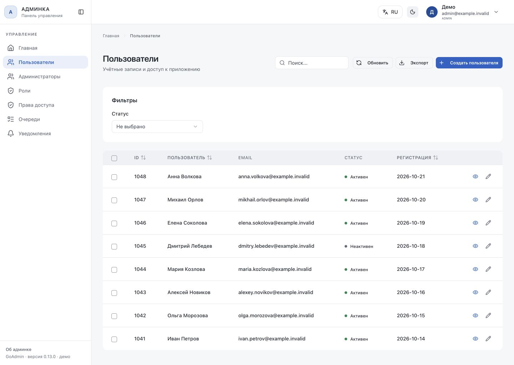
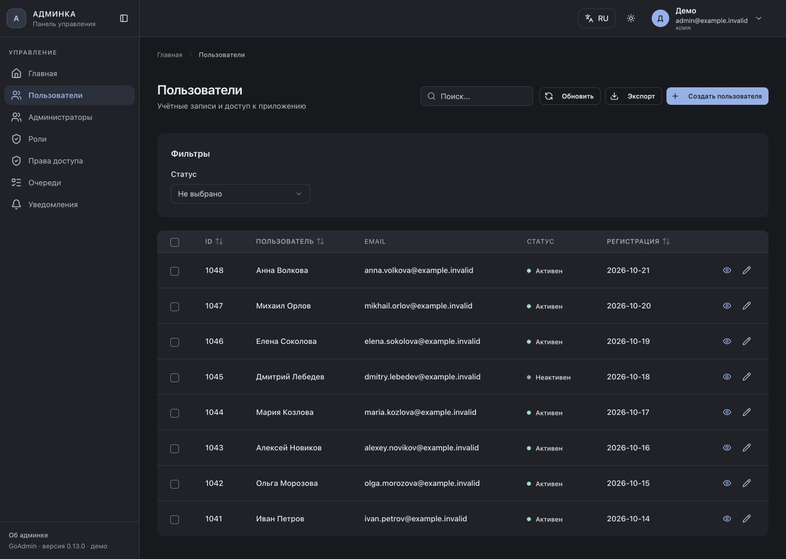
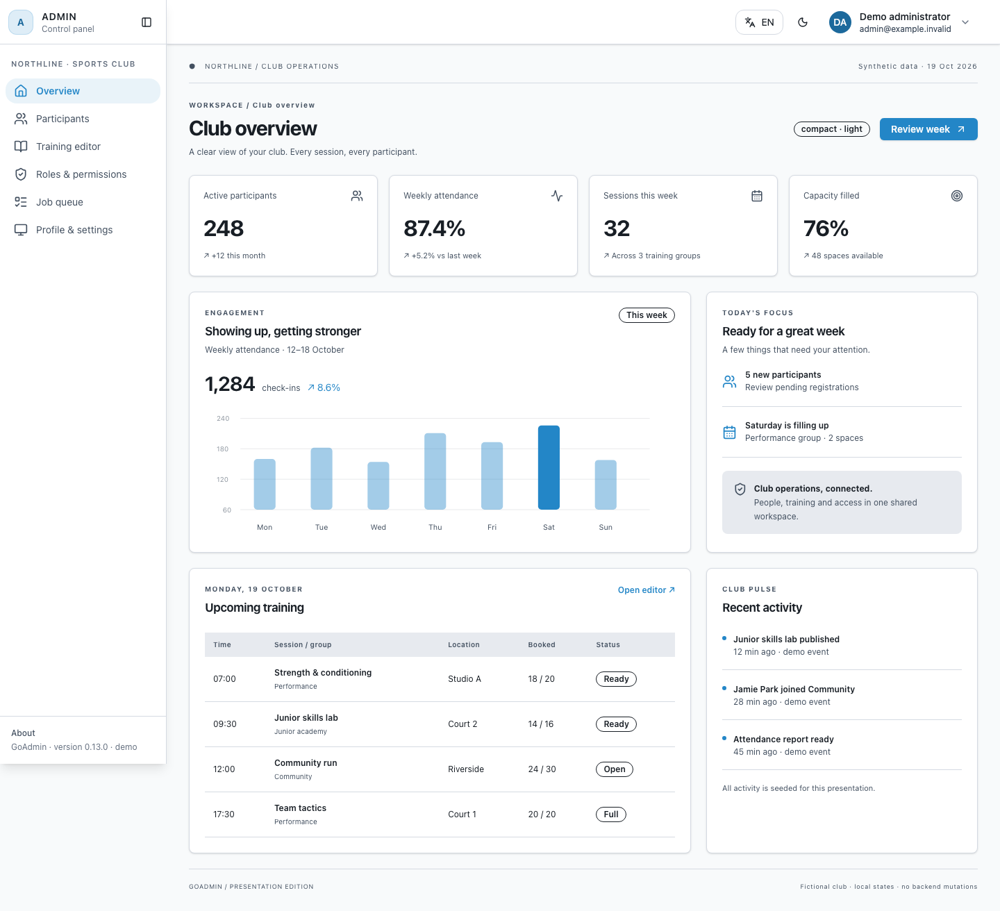
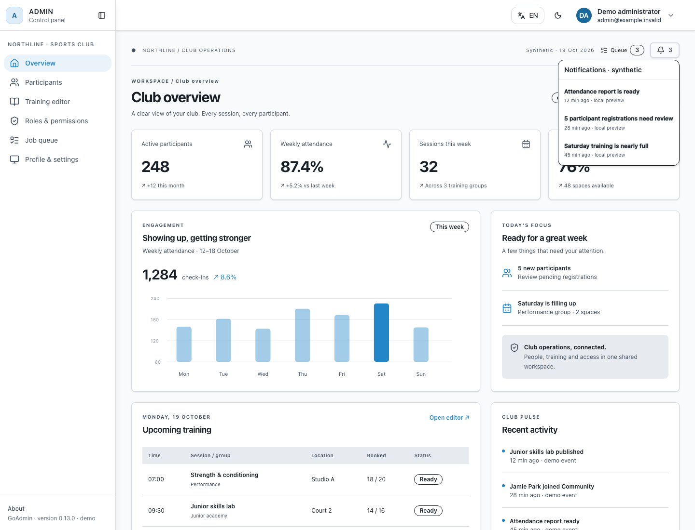
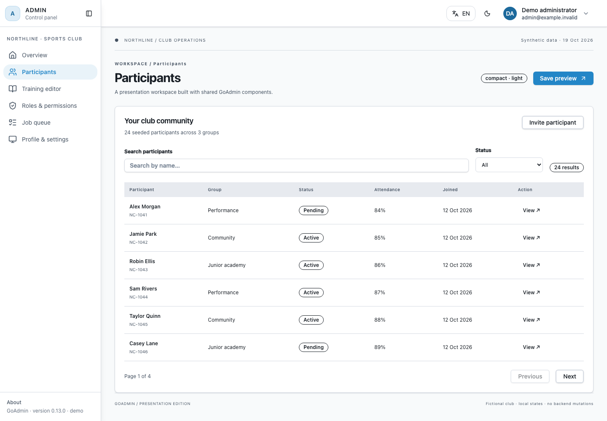
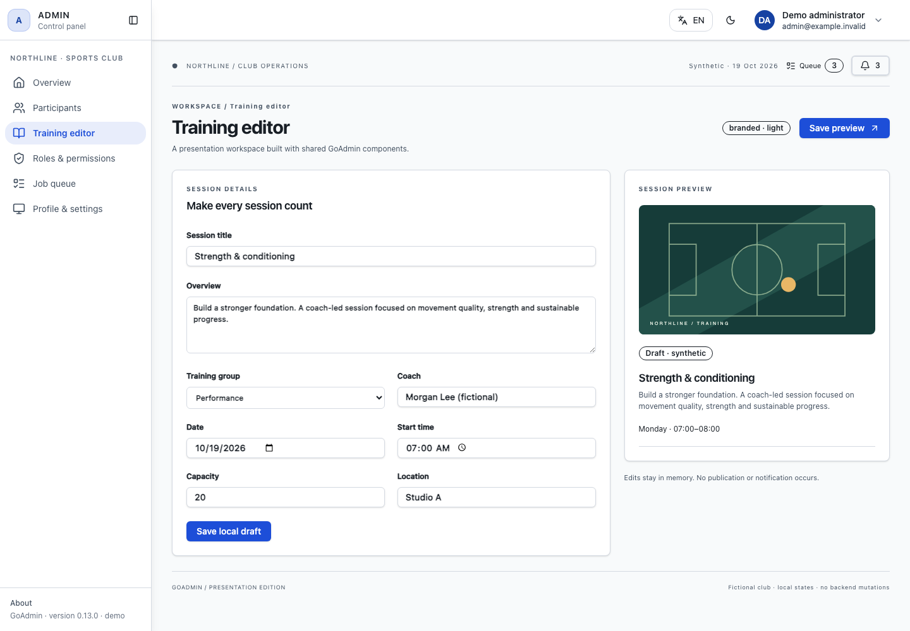
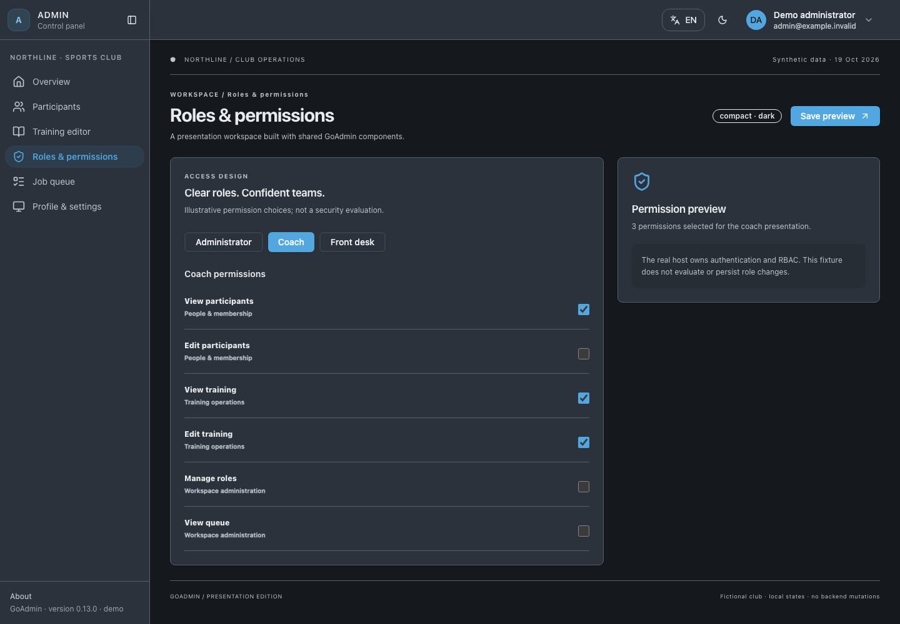
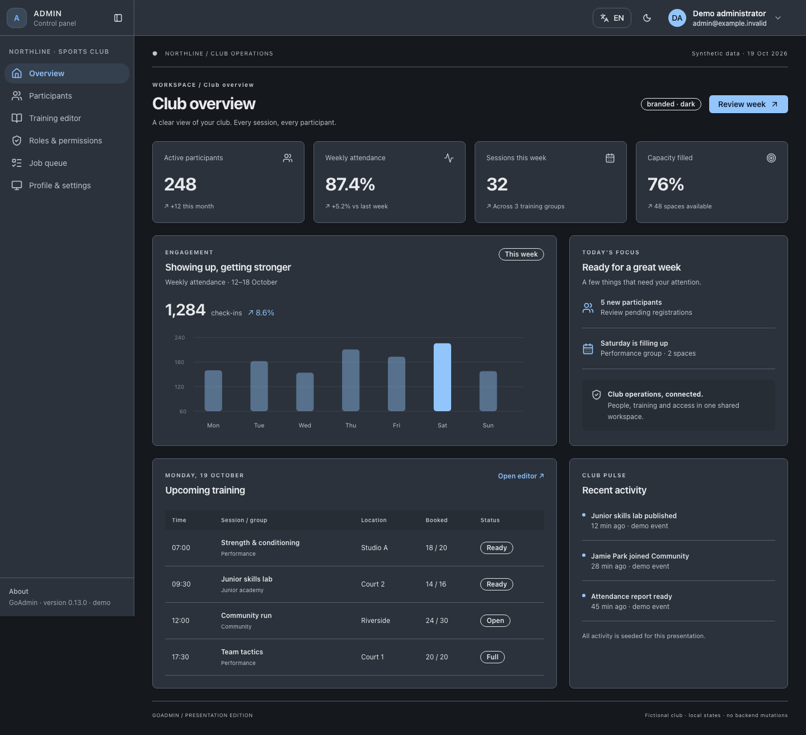
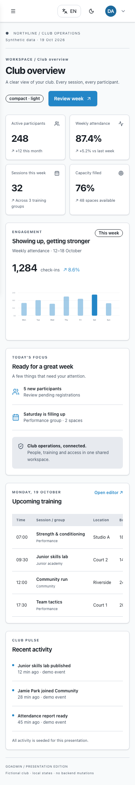

# Admin UI previews

## Default light and dark themes

The default theme uses neutral light surfaces, graphite dark surfaces and a
restrained blue accent. State indicators use a colored dot with a readable label;
counts and role/category labels retain badges. The existing layout, information
density, light/dark preference and host CSS overrides remain in place.

These screenshots show the real users page and shared components with synthetic
accounts, captured at **1440 × 1024**, 1× device scale:





Run the read-only visual fixture from the repository root:

```sh
npm ci --prefix resources
node resources/audit/design/server.mjs
```

Open <http://127.0.0.1:8768/users>. Additional routes are
`/users/1048/edit`, `/auth/login` and `/__design/components` (form states, buttons,
rich text and a dialog). Use the real header controls to change theme or language.
Stop with Ctrl-C. The server binds only to localhost and uses temporary extension
sources; it does not overwrite the developer's extension registry.

This fixture exercises real Vue screens without an authenticated backend.
Filtering and search read deterministic local data; submissions return 405.
Export, other sidebar destinations, authentication and persistent saves are not
implemented. The create route displays the same edit-form sample. It is visual
acceptance evidence, not a host integration or backend acceptance test.

Additional captures: [form](screenshots/design-refresh/form-light.png),
[dark dialog](screenshots/design-refresh/dialog-dark.png),
[mobile login](screenshots/design-refresh/login-mobile.png),
[mobile users](screenshots/design-refresh/users-mobile-light.png) and
[tablet users](screenshots/design-refresh/users-tablet.png).
See the [design QA report](../design-qa.md) for comparison evidence and limits.

## Sports club presentation demo

Northline is a fictional sports club workspace demonstrating the real GoAdmin
Vue shell, navigation, cards, buttons, inputs and badges. Data is deterministic
and synthetic, anchored to **19 October 2026**. No account or backend is required.

## Run locally

From the repository root, with the Node/npm version supported by `resources`:

```sh
npm ci --prefix resources
npm ci --prefix resources/demo/sports-club
node resources/demo/sports-club/server.mjs
```

Open <http://127.0.0.1:8767/demo/dashboard>. The separate fixture binds only to
`127.0.0.1:8767` and never changes the library's production routes or entry point.
Stop it with Ctrl-C. Empty extension sources are created in an owned temporary
directory, resolved through demo-only Vite aliases, and removed on shutdown.
The developer’s `resources/.admin-extensions` state is neither loaded nor overwritten.
Host extensions are intentionally absent.

The six screens are `dashboard`, `participants`, `training`, `permissions`,
`queue`, and `settings`, all below `/demo/`. Add `?preset=default`,
`?preset=compact`, or `?preset=branded`; add `&mode=dark` for a dark start.
Compact is the default. Branded composes the existing compact and brand theme
extensions. The shared header also supports live theme switching.

## Reproduce the gallery

With the demo server running, in a second terminal:

```sh
# One-time browser setup for the demo's pinned Playwright version:
cd resources/demo/sports-club
npx playwright install chromium
npm test
npm run capture
```

`capture.mjs` uses Chromium, 1× device scale, en-GB locale, UTC, reduced motion,
a fresh browser context per screenshot, and stable fixture data. It waits for
fonts, images, network idle and two layout frames. It rejects console/page errors,
external requests, document overflow and missing active navigation. Tables use
intentional local horizontal scrolling on narrow screens.

Representative interaction checks cover filters, pagination, row actions, editor
preview/save, separate role selections, shared theme and profile menus, and mobile
menu focus wrapping, Escape dismissal and focus return. The synthetic notification
dropdown and queue indicator are demo-only capability cues; the existing access
screen includes fictional administrator assignments. No extra feature page is added. This is deliberately a
curated presentation check rather than every screen/theme/viewport combination.

To reuse an existing installation, set `PLAYWRIGHT_MODULE` to its absolute
`playwright/index.mjs` and optionally `PLAYWRIGHT_EXECUTABLE_PATH` to its Chromium
binary. Browser/platform font changes can change pixels. The committed
`capture-manifest.json` records the actual Playwright package version, Chromium
version and viewport used for this gallery.

## Sports club gallery — earlier visual baseline

These seven captures predate the default-theme refresh. They illustrate the
demo's capabilities and optional presets, not the current default appearance.
Running the demo uses the current shared components; regenerate its gallery to
capture a later visual baseline.

Seven curated viewport images show capabilities rather than every available page.
Desktop dashboards use **1440 × 1100**, tables/forms/access use **1440 × 1000**,
and mobile uses **390 × 844**. Captures use `fullPage: false`, including the README
hero, so the shared fixed sidebar fills the viewport naturally. Scroll locally to
explore the rest of each page; production positioning is unchanged.

### Overview · compact · light



### Notifications · shared dropdown · synthetic



### Tables · compact · light



### Forms · branded · light



### Access · compact · dark



### Theme extension · branded · dark



### Responsive shell · compact · mobile



## Boundaries and limitations

This is a presentation fixture, not an authenticated host integration. Mutations
only show local notices or edit in-memory state; reload resets them. Permission
checkboxes and administrator assignments are illustrative, never backend-verified
authorization. Notification items are seeded and only open local notices. Queue jobs,
activity and metrics are seeded snapshots: no workers, notifications, mail,
security checks, uploads or external services execute. The court SVG is a local
original placeholder. Names and `example.invalid` addresses are fictional.

Shared header profile/settings/logout destinations belong to the production
shell and are not implemented by this fixture; use the demo sidebar for its
profile/settings screen. The profile menu is exercised for opening and focus
return only. Shared component defects are not hidden with replacement CSS.
The demo is outside `src`; the production entry never imports it, and production
Tailwind scanning excludes the demo directory. No CI workflow is added.
