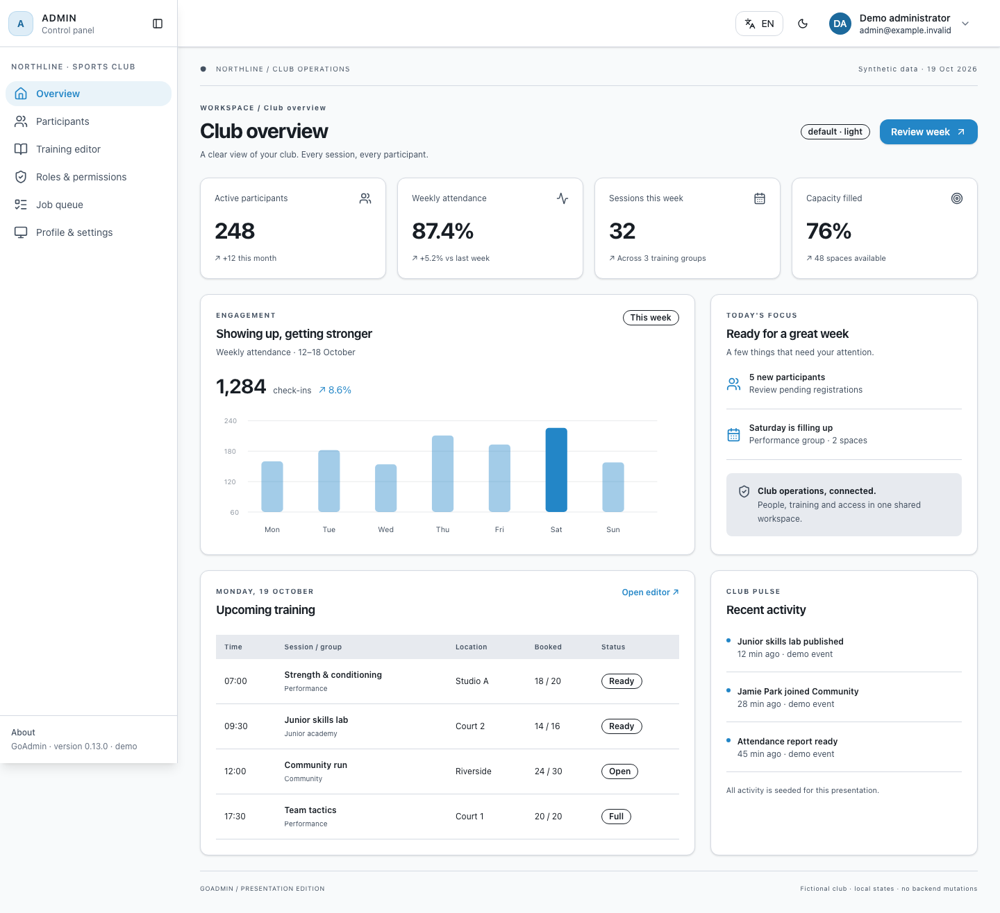
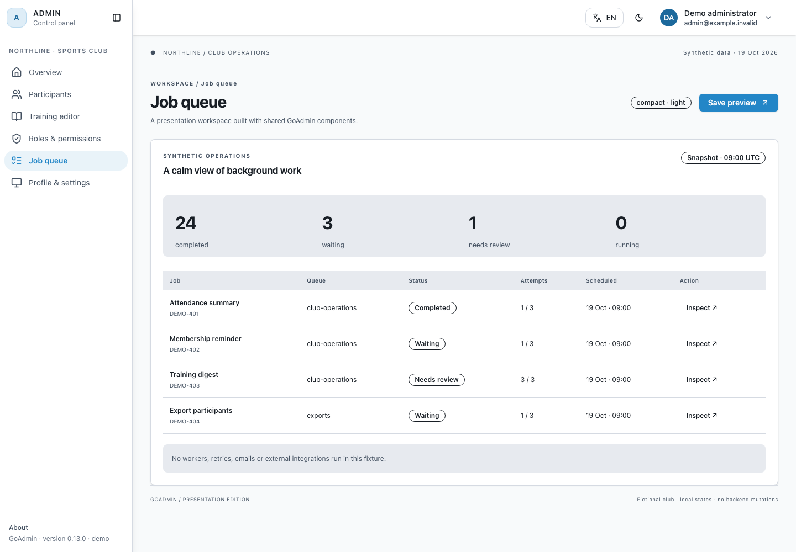
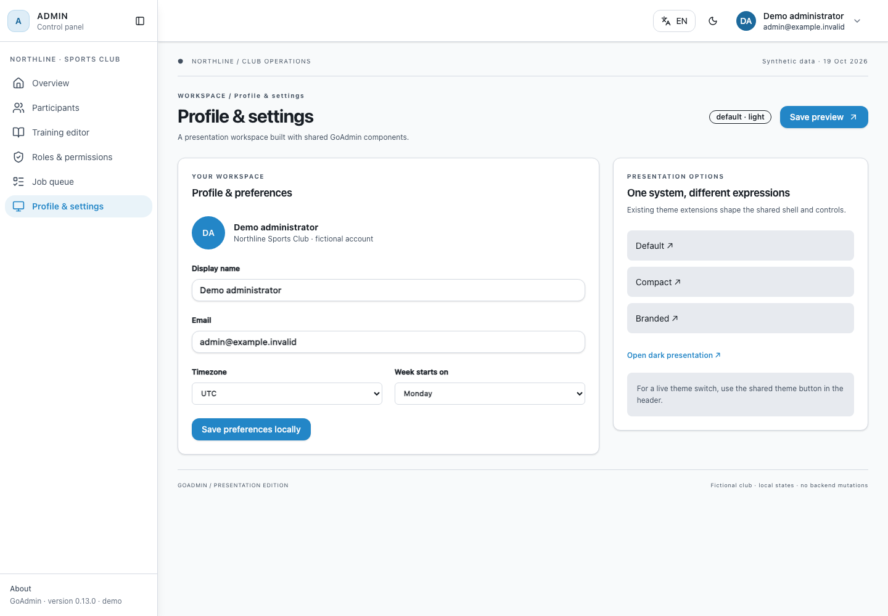
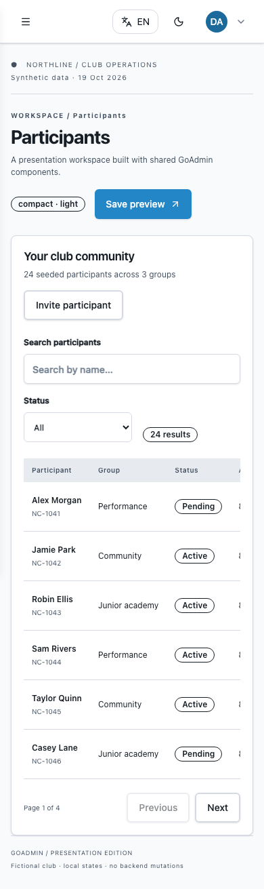

# Sports club presentation demo

Northline is a fictional sports club workspace demonstrating the real GoAdmin
Vue shell, navigation, cards, buttons, inputs and badges. Data is deterministic
and synthetic, anchored to **19 October 2026**. No account or backend is required.

## Run locally

From the repository root, with the Node/npm version supported by `resources`:

```sh
npm ci --prefix resources
npm ci --prefix resources/demo/sports-club
node resources/demo/sports-club/server.mjs
```

Open <http://127.0.0.1:8767/demo/dashboard>. The separate fixture binds only to
`127.0.0.1:8767` and never changes the library's production routes or entry point.
Stop it with Ctrl-C. The demo materializes the same empty extension scaffolding
used by the existing UI browser fixture. Host extensions are intentionally absent.

The six screens are `dashboard`, `participants`, `training`, `permissions`,
`queue`, and `settings`, all below `/demo/`. Add `?preset=default`,
`?preset=compact`, or `?preset=branded`; add `&mode=dark` for a dark start.
Compact is the default. Branded composes the existing compact and brand theme
extensions. The shared header also supports live theme switching.

## Reproduce the gallery

With the demo server running, in a second terminal:

```sh
# One-time browser setup for the demo's pinned Playwright version:
cd resources/demo/sports-club
npx playwright install chromium
npm test
npm run capture
```

`capture.mjs` uses Chromium, 1× device scale, en-GB locale, UTC, reduced motion,
a fresh browser context per screenshot, and stable fixture data. It waits for
fonts, images, network idle and two layout frames. It rejects console/page errors,
external requests, document overflow and missing active navigation. Tables use
intentional local horizontal scrolling on narrow screens.

Representative interaction checks cover filters, pagination, row actions, editor
preview/save, separate role selections, shared theme and profile menus, and mobile
menu focus wrapping, Escape dismissal and focus return. This is deliberately a
curated presentation check rather than every screen/theme/viewport combination.

To reuse an existing installation, set `PLAYWRIGHT_MODULE` to its absolute
`playwright/index.mjs` and optionally `PLAYWRIGHT_EXECUTABLE_PATH` to its Chromium
binary. Browser/platform font changes can change pixels. The committed
`capture-manifest.json` records the browser and viewport used for this gallery.

## Gallery

All images are committed repo-relative PNGs. Desktop viewport is **1440 × 1100**
for dashboards and **1440 × 1000** for other views; mobile is **390 × 844**.
Images capture the full page, so image height may exceed viewport height.

### Dashboard · compact · light · desktop (README hero)


### Dashboard · default · light · desktop



### Dashboard · branded · dark · desktop


### Participants · compact · light · desktop


### Training editor · branded · light · desktop


### Roles and permissions · compact · dark · desktop


### Job queue · compact · light · desktop



### Profile and settings · default · light · desktop



### Dashboard · compact · light · mobile


### Participants · compact · light · mobile



## Boundaries and limitations

This is a presentation fixture, not an authenticated host integration. Mutations
only show local notices or edit in-memory state; reload resets them. Permission
checkboxes are illustrative, never backend-verified authorization. Queue jobs,
activity and metrics are seeded snapshots: no workers, notifications, mail,
security checks, uploads or external services execute. The court SVG is a local
original placeholder. Names and `example.invalid` addresses are fictional.

Shared header profile/settings/logout destinations belong to the production
shell and are not implemented by this fixture; use the demo sidebar for its
profile/settings screen. The profile menu is exercised for opening and focus
return only. Shared component defects are not hidden with replacement CSS.
The demo is outside `src`; the production entry never imports it, and production
Tailwind scanning excludes the demo directory. No CI workflow is added.
